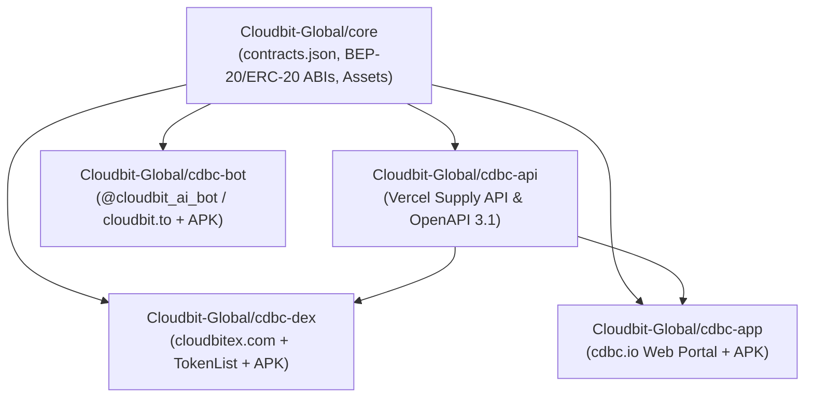

<div align="center">
  <a href="https://cdbc.io">
    
  </a>

  <h1>Cloudbit Classic (<code>$CDBC</code>) &mdash; Cloudbit-Global</h1>
  <p><strong>Open-source multichain contract registry, decentralized exchange infrastructure, serverless supply API, Telegram GameFi bot, and signed Android applications for Cloudbit Classic ($CDBC).</strong></p>

  <p>
    <a href="https://bscscan.com/token/0xaf8b1b1bb4a47f537932968C7DE6E251dd50C6a9"></a>
    <a href="https://cdbc-api.vercel.app/api/cdbc/supply"></a>
    
    <a href="https://github.com/Cloudbit-Global/cdbc-app/releases/latest"></a>
    <a href="https://github.com/Cloudbit-Global/core/blob/main/LICENSE"></a>
  </p>

  <p>
    <a href="https://github.com/Cloudbit-Global/core/actions"></a>
    <a href="https://github.com/Cloudbit-Global/cdbc-dex/actions"></a>
    <a href="https://github.com/Cloudbit-Global/cdbc-api/actions"></a>
  </p>

  <p>
    <a href="https://cdbc.io">cdbc.io</a> &bull;
    <a href="https://cloudbitex.com">cloudbitex.com (CloudbitDEX)</a> &bull;
    <a href="https://cdbc-api.vercel.app/api/cdbc/supply">Public API</a> &bull;
    <a href="https://cloudbit.to">cloudbit.to</a> &bull;
    <a href="https://t.me/cloudbit_ai_bot">@cloudbit_ai_bot</a> &bull;
    <a href="https://x.com/cloudbit_">X (@cloudbit_)</a> &bull;
    <a href="https://instagram.com/cloudbit.official">Instagram</a>
  </p>
</div>

---

## Ecosystem Repositories & Capabilities

| Repository | Production Host | Stack | Core Responsibility |
| :--- | :--- | :--- | :--- |
| **[`core`](https://github.com/Cloudbit-Global/core)** | `cdbc.io` | JSON, Solidity ABIs, PNG | Single source of truth for verified multichain contracts, BEP-20/ERC-20 ABIs, tokenomics, and official brand assets. |
| **[`cdbc-dex`](https://github.com/Cloudbit-Global/cdbc-dex)** | `cloudbitex.com` | HTML5, JS, PHP, Web3 SDKs, Android | CloudbitDEX multichain swap router (`0.25%` router + `0.25%` LP fee), Uniswap-standard `tokenlist.json`, listing portal, and signed Android APK. |
| **[`cdbc-app`](https://github.com/Cloudbit-Global/cdbc-app)** | `cdbc.io` | HTML5, CSS3, JS, Android | Official dark-mode Web3 portal, multichain contract hub, IONOS release pipelines, and signed `CDBC.IO` Android APK. |
| **[`cdbc-api`](https://github.com/Cloudbit-Global/cdbc-api)** | `cdbc-api.vercel.app` | Vercel Serverless, OpenAPI 3.1 | Public, zero-auth REST endpoints serving fixed total and circulating supply metrics for CoinMarketCap, CoinGecko, and exchanges. |
| **[`cdbc-bot`](https://github.com/Cloudbit-Global/cdbc-bot)** | `cloudbit.to` / `@cloudbit_ai_bot` | Python / Node.js, Telegram Bot API, Android | Telegram GameFi & Tap2Earn Mini App backend configuration and signed `CDBC-BOT` Android APK. |

---

## Verified Smart Contract Registry

### Primary Main Contract (Liquidity & Governance Anchor)
* **BNB Smart Chain (BEP-20):** `0xaf8b1b1bb4a47f537932968C7DE6E251dd50C6a9` ([BscScan](https://bscscan.com/token/0xaf8b1b1bb4a47f537932968C7DE6E251dd50C6a9))
* **Tokenomics:** `200,000,000 CDBC` fixed maximum supply | `0% Buy Tax / 0% Sell Tax` | `18` decimals (EVM)

### Verified Multichain Bridge Contracts

| Network | Standard | Contract Address | Explorer |
| :--- | :--- | :--- | :--- |
| **Ethereum** | ERC-20 | `0xf2fef8fa2c52b927c0a589a1a645c77189f24541` | [Etherscan](https://etherscan.io/token/0xf2fef8fa2c52b927c0a589a1a645c77189f24541) |
| **Arbitrum One** | ERC-20 | `0xdc95becd16081bf00c3cabac5820a3e18b495cad` | [Arbiscan](https://arbiscan.io/token/0xdc95becd16081bf00c3cabac5820a3e18b495cad) |
| **Polygon (PoS)** | ERC-20 | `0x026a2ede22cc9525793120a3763d3a1c2c6840a8` | [Polygonscan](https://polygonscan.com/token/0x026a2ede22cc9525793120a3763d3a1c2c6840a8) |
| **Optimism** | ERC-20 | `0x92f1950d8c80a2d844b321e65e226a694801cc13` | [Optimistic Etherscan](https://optimistic.etherscan.io/token/0x92f1950d8c80a2d844b321e65e226a694801cc13) |
| **Avalanche C-Chain** | ARC-20 | `0x7462617313b26d7b72daed71a852e51588f7f1a7` | [Snowtrace](https://snowtrace.io/token/0x7462617313b26d7b72daed71a852e51588f7f1a7) |
| **Base** | ERC-20 | `0x35d545a52a8dd6abb588292ea6b7b9cb3898b53b` | [Basescan](https://basescan.org/token/0x35d545a52a8dd6abb588292ea6b7b9cb3898b53b) |
| **Solana** | SPL | `J74E2uSud3EH2aAUNLaxMRDyHde7oHDYopGLaim4DZta` | [Solscan](https://solscan.io/token/J74E2uSud3EH2aAUNLaxMRDyHde7oHDYopGLaim4DZta) |
| **Aptos** | Aptos Coin | `0x6917bec3bdfe7423619c1e128f8bebdc62405377aaf32365283e2ec5353fe1f7::coin::T` | [Aptos Explorer](https://explorer.aptoslabs.com/coin/0x6917bec3bdfe7423619c1e128f8bebdc62405377aaf32365283e2ec5353fe1f7::coin::T) |
| **Terra Classic** | CW-20 | `terra1q20zrqn278jm6e4a2z5ygky00h22l4js7wsge74xf4wwyald4r8qsyvyuj` | [Terra Finder](https://finder.terra.money/classic/address/terra1q20zrqn278jm6e4a2z5ygky00h22l4js7wsge74xf4wwyald4r8qsyvyuj) |

> **Upcoming Bridge Integrations (15-Chain Expansion):** Sonic, NEAR, Sui, World, Terra, Cronos, Fantom, Gnosis, Kava, Moonbeam, and Celo (*Upcoming Bridge Integration* — official addresses will be published in `Cloudbit-Global/core` upon deployment).

---

## Quick Start & Integration Examples

### Prerequisites
* `git` >= 2.40 and `curl` (or PowerShell 7+)
* Node.js >= 20 LTS (for EVM SDK integrations) or Python >= 3.11 (for registry/bot tooling)

### 1. Query Live Supply Metrics (`cdbc-api`)
```bash
# Full supply and primary contract metadata
curl -s https://cdbc-api.vercel.app/api/cdbc/supply

# Raw total supply (200000000)
curl -s https://cdbc-api.vercel.app/api/cdbc/total-supply

# Raw circulating supply (200000000)
curl -s https://cdbc-api.vercel.app/api/cdbc/circulating-supply
```

### 2. Fetch Verified Contract Registry & ABI (`core`)
```javascript
import { ethers } from "ethers";

const REGISTRY_URL = "https://raw.githubusercontent.com/Cloudbit-Global/core/main/registry/contracts.json";
const ABI_URL = "https://raw.githubusercontent.com/Cloudbit-Global/core/main/abi/CDBC_BEP20.abi.json";

const [registry, abi] = await Promise.all([
  fetch(REGISTRY_URL).then((r) => r.json()),
  fetch(ABI_URL).then((r) => r.json()),
]);

const provider = new ethers.JsonRpcProvider("https://bsc-dataseed.binance.org/");
const cdbc = new ethers.Contract(registry.primary_contract.address, abi, provider);

const [symbol, totalSupply] = await Promise.all([cdbc.symbol(), cdbc.totalSupply()]);
console.log(`${symbol} Total Supply:`, ethers.formatUnits(totalSupply, 18));
```

### 3. Download & Verify Official Android APKs (`v3.0.0`)
All official Android packages ship with a companion `.sha256` checksum asset:

```bash
# Example: Download and verify CloudbitDEX v3.0.0 on Linux/macOS
curl -LO https://github.com/Cloudbit-Global/cdbc-dex/releases/download/v3.0.0/CloudbitDEX-v3.0.0.apk
curl -LO https://github.com/Cloudbit-Global/cdbc-dex/releases/download/v3.0.0/CloudbitDEX-v3.0.0.apk.sha256
sha256sum -c CloudbitDEX-v3.0.0.apk.sha256
```

```powershell
# Windows PowerShell SHA-256 verification
Get-FileHash .\CloudbitDEX-v3.0.0.apk -Algorithm SHA256
```

| Application | Latest Release | Direct APK | Checksum |
| :--- | :--- | :--- | :--- |
| **CDBC.IO** (`cdbc.io`) | `v3.0.0` | [CDBC-io-v3.0.0.apk](https://github.com/Cloudbit-Global/cdbc-app/releases/download/v3.0.0/CDBC-io-v3.0.0.apk) | [.sha256](https://github.com/Cloudbit-Global/cdbc-app/releases/download/v3.0.0/CDBC-io-v3.0.0.apk.sha256) |
| **CloudbitDEX** (`cloudbitex.com`) | `v3.0.0` | [CloudbitDEX-v3.0.0.apk](https://github.com/Cloudbit-Global/cdbc-dex/releases/download/v3.0.0/CloudbitDEX-v3.0.0.apk) | [.sha256](https://github.com/Cloudbit-Global/cdbc-dex/releases/download/v3.0.0/CloudbitDEX-v3.0.0.apk.sha256) |
| **CDBC-BOT** (`cloudbit.to`) | `v3.0.0` | [CDBC-Bot-v3.0.0.apk](https://github.com/Cloudbit-Global/cdbc-bot/releases/download/v3.0.0/CDBC-Bot-v3.0.0.apk) | [.sha256](https://github.com/Cloudbit-Global/cdbc-bot/releases/download/v3.0.0/CDBC-Bot-v3.0.0.apk.sha256) |

---

## Architecture & Repository Topology



```text
Cloudbit-Global/
├── .github/          # Org profile README, shared Issue/PR templates, SECURITY.md, CONTRIBUTING.md
├── core/             # registry/contracts.json, abi/*.abi.json, assets/cdbc-logo-256.png
├── cdbc-dex/         # tokenlist.json, config/dex-config.json, CloudbitDEX web + APK releases
├── cdbc-app/         # cdbc.io web build, IONOS release workflow, CDBC.IO APK releases
├── cdbc-api/         # openapi.yaml, Vercel serverless supply endpoints, live API CI monitor
└── cdbc-bot/         # .env.example, Telegram Mini App config, CDBC-BOT APK releases
```

---

## Roadmap & Contributing

* **Live:** 10 verified networks (`BNB Smart Chain` primary + 9 bridges), CloudbitDEX multichain swaps & listing portal, Vercel serverless supply API, and `v3.0.0` signed Android APKs.
* **In Progress:** DNS domain verification across `cdbc.io`, `cloudbitex.com`, and `cloudbit.to`; unified `ci.yml` enforcement across all repositories.
* **Upcoming:** 15-chain bridge expansion (Sonic, NEAR, Sui, World, Terra, Cronos, Fantom, Gnosis, Kava, Moonbeam, Celo) and automated release changelog generation.

Contributions, wallet/exchange integration PRs, and security reports are welcome. Review [`CONTRIBUTING.md`](https://github.com/Cloudbit-Global/.github/blob/main/CONTRIBUTING.md) and [`SECURITY.md`](https://github.com/Cloudbit-Global/.github/blob/main/SECURITY.md) before opening a pull request.
